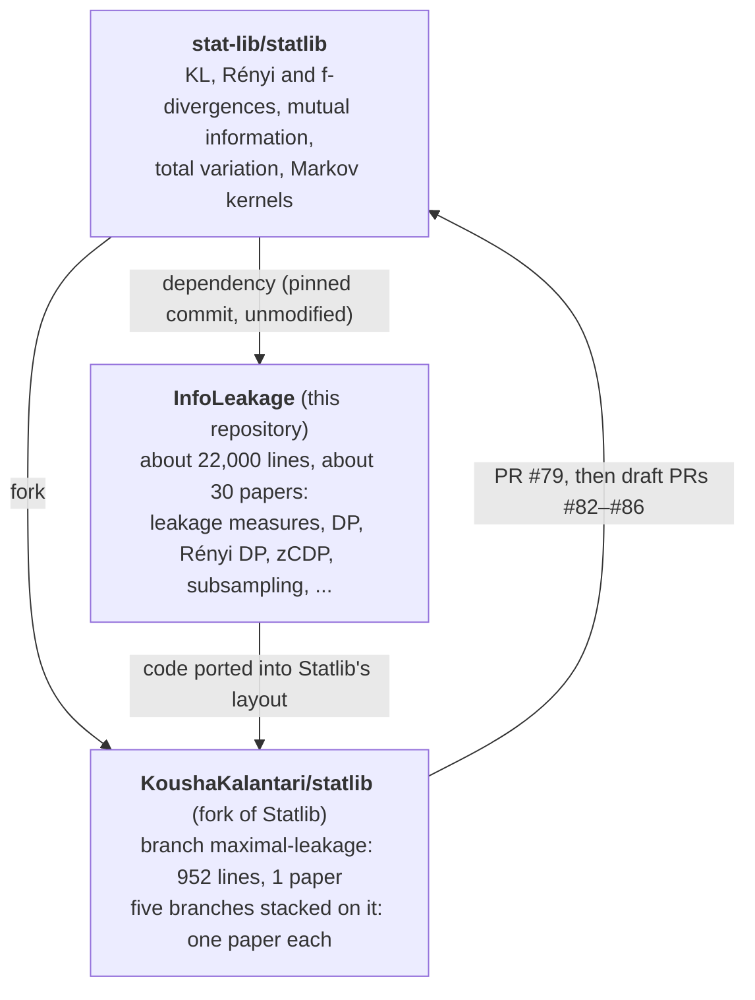

# InfoLeakage

Machine-checked mathematics of privacy and information leakage in Lean 4. Differential privacy:
pure and approximate DP with post-processing, group privacy, basic and advanced composition, the
standard mechanisms (randomized response, Laplace, geometric, exponential, Gaussian with its exact
privacy profile, report noisy max, sparse vector, continual counting), Rényi DP,
zero-concentrated DP, f-DP and amplification by subsampling. Related privacy definitions and
attacks: metric privacy and geo-indistinguishability, Pufferfish, privacy breaches and the
Bayesian semantics of DP, mutual-information DP and identifiability, and reconstruction attacks.
Information measures: perfect secrecy, min-entropy and
g-leakage, maximal leakage, pointwise maximal leakage, max-information, information privacy,
Sibson/Arimoto α-mutual information, α-leakage, f-information with Pinsker's inequality, local
privacy, semantic security for the wiretap channel, and directed information. Built on
[Statlib](https://github.com/stat-lib/statlib) and [Mathlib](https://github.com/leanprover-community/mathlib4).
See [ROADMAP.md](ROADMAP.md).

> **Early-stage work.** Definitions and generality may change after discussion with the
> Statlib community. The code was written with AI assistance (Claude Code), and the author is
> reviewing it line by line.

## Build

```sh
lake exe cache get   # prebuilt Mathlib
lake build
```

Toolchain: `leanprover/lean4:v4.36.0-rc2` (pinned to match Statlib).

## Relationship to Statlib

This library depends on Statlib and does not modify it. Parts of it are being proposed for
inclusion in Statlib itself: they are ported into Statlib's layout on branches of a fork and
submitted as pull requests (design discussion:
[stat-lib/statlib#78](https://github.com/stat-lib/statlib/issues/78)). State as of 2026-11-13:



The leakage measures go to Statlib as a stack: #79 first, and each later PR adds one paper on
top of it.

| PR | Adds | Paper |
|---|---|---|
| [#79](https://github.com/stat-lib/statlib/pull/79) | `Divergence/MaximalLeakage/` | Issa–Wagner–Kamath |
| [#82](https://github.com/stat-lib/statlib/pull/82) (draft) | `Divergence/AlphaLeakage/` | Liao–Kosut–Sankar–Calmon |
| [#83](https://github.com/stat-lib/statlib/pull/83) (draft) | `Divergence/RenyiInfinity/` | Kurri–Kosut–Sankar |
| [#84](https://github.com/stat-lib/statlib/pull/84) (draft) | `Divergence/GainLeakage/` | Kurri–Sankar–Kosut |
| [#85](https://github.com/stat-lib/statlib/pull/85) (draft) | `Divergence/AlphaBetaLeakage/` | Gilani–Kurri–Kosut–Sankar |
| [#86](https://github.com/stat-lib/statlib/pull/86) (draft) | `Privacy/DPHamming/` | Kalantari–Sankar–Sarwate |

## Status

Main results of about fifty papers and books are formalized, mostly for finite alphabets; the
DP, Rényi DP, zCDP, mechanism and f-information results hold on general measurable spaces.
About 35,000 lines; no `sorry`. Every declaration uses only Lean's standard axioms (checked by a
script over the whole library). The library passes the Mathlib linters and `lake lint`. Each paper's statements were adversarially reviewed against the
paper by a second AI reviewer, and every fix raised was applied: OpenAI Codex for the six leakage
papers, and an independent Claude referee for everything else (Codex review of those is
pending). Module docstrings map each paper result to its Lean name and say exactly what is and
isn't formalized.

### Differential privacy

| Source | Directory | Formalized |
|---|---|---|
| Dwork, Roth, *The algorithmic foundations of differential privacy*, 2014; Dwork, McSherry, Nissim, Smith, TCC 2006 | `DP/Basic.lean` | ε- and (ε,δ)-DP of kernels; post-processing (Prop. 2.1); group privacy (Thm. 2.2); composition of two mechanisms, adaptive (Thm. B.1) and k-fold (Thm. 3.16, Cor. 3.15); parallel composition (McSherry, SIGMOD 2009, two parts) |
| Warner, JASA 1965; Kairouz, Oh, Viswanath, JMLR 2016; Dwork–Roth Ch. 3; McSherry, Talwar, FOCS 2007; Ghosh, Roughgarden, Sundararajan, STOC 2009 | `DP/{RandomizedResponse,Laplace,Exponential,Geometric}.lean` | Binary and k-ary randomized response with exact privacy level (Claim 3.5); Laplace mechanism (Thm. 3.6, scalar and ℓ₁; Fact 3.7; Thm. 3.8); exponential mechanism (Thms. 3.10–3.11, Cor. 3.12); geometric mechanism |
| Mironov, *Rényi differential privacy*, CSF 2017 ([arXiv:1702.07476](https://arxiv.org/abs/1702.07476)) | `RenyiDP/` | Def. 4, post-processing, adaptive composition (Prop. 1), ε-DP ⇔ RDP at all orders, RDP ⇒ (ε,δ)-DP (Prop. 3), Props. 2, 9–11, randomized response (Prop. 5), Laplace mechanism (Prop. 6, Cor. 2) |
| Bun, Steinke, *Concentrated differential privacy*, TCC 2016 ([arXiv:1605.02065](https://arxiv.org/abs/1605.02065)) | `ZCDP/` | Def. 1.1, Lemmas 1.7–1.8, 2.3–2.4, 3.2, 3.5, Props. 1.3, 1.4, 1.6 (Gaussian mechanism); k-fold composition bound; zCDP ⇔ RDP at every order |
| Dong, Roth, Su, *Gaussian differential privacy* ([arXiv:1905.02383](https://arxiv.org/abs/1905.02383)) | `FDP/` | See the landmark table below |
| Balle, Barthe, Gaboardi, *Privacy amplification by subsampling*, NeurIPS 2018 ([arXiv:1807.01647](https://arxiv.org/abs/1807.01647)) | `Amplification/` | Hockey-stick divergence, Thm. 1 ((ε,δ)-DP ⇔ hockey-stick bound), Thm. 2 (advanced joint convexity), Thms. 8–9 (Poisson subsampling, sampling without replacement), Thm. 13 (tightness) |
| Dwork, Rothblum, Vadhan, *Boosting and differential privacy*, FOCS 2010; Dwork–Roth Thm. 3.20, Cor. 3.21 | `AdvancedComposition/` | Advanced composition of ε-DP mechanisms, adaptive and non-adaptive, via zCDP (with the sharper kε²/2 term); Cor. 3.21 under δ′ ≤ e^{−ε′/8} |
| Balle, Wang, *Improving the Gaussian mechanism for differential privacy*, ICML 2018 ([arXiv:1805.06530](https://arxiv.org/abs/1805.06530)); Dong–Roth–Su Cor. 2.13; Dwork–Roth Thm. A.1 | `AnalyticGaussian/` | Exact privacy profile of the Gaussian mechanism (Thm. 8, Lemma 6, Thm. 5), Thms. 1, 2, 4 (corrected), Lemmas 3, 7; classical calibration (scalar queries) |
| Dwork–Roth Claim 3.9, Thm. 3.23; Lyu, Su, Li, *Understanding the sparse vector technique*, VLDB 2017 ([arXiv:1603.01699](https://arxiv.org/abs/1603.01699)) | `SparseVector/` | Report noisy max; AboveThreshold (fixed query sequence); Lyu–Su–Li Thm. 4 (c = 1) and Thm. 3 (the variant without query noise is not DP) |
| Kairouz, Oh, Viswanath, *The composition theorem for differential privacy*, ICML 2015 / IEEE T-IT 2017 ([arXiv:1311.0776](https://arxiv.org/abs/1311.0776)) | `OptimalComposition/` | The canonical (ε,δ) pair; (ε,δ)-DP ⇔ post-processing of it (Thms. 2.1, 2.4, and 2.5 for the canonical pair, finite alphabets); the exact optimal k-fold composition (Thm. 3.3), non-adaptive and adaptive, with tightness |
| Nissim, Raskhodnikova, Smith, *Smooth sensitivity and sampling in private data analysis*, STOC 2007 | `SmoothSensitivity/` | Local and smooth sensitivity, Lemma 2.3 (smallest smooth bound), admissible noise (Def. 2.5, d = 1), Lemma 2.6 (with the δ its proof gives), Lemma 2.9 and Cor. 2.4(2) for Laplace noise |
| Chaudhuri, Monteleoni, Sarwate, *Differentially private empirical risk minimization*, JMLR 2011 ([arXiv:0912.0071](https://arxiv.org/abs/0912.0071)) | `PrivateERM/` | Lemma 1, Cor. 1 (sensitivity 2/(nΛ) of regularized ERM), Thm. 1 (output perturbation is ε-DP), Cor. 2 (logistic regression) |
| Chan, Shi, Song, *Private and continual release of statistics*, ACM TISSEC 2011; Dwork, Naor, Pitassi, Rothblum, STOC 2010 | `ContinualRelease/` | Privacy of the p-sum, simple, two-level and binary counting mechanisms (Obs. 1, §3.1, Thms. 3.1, 3.3, 3.5 corrected, with tightness) |

### Information measures

| Source | Directory | Formalized |
|---|---|---|
| Dwork, Feldman, Hardt, Pitassi, Reingold, Roth, *Generalization in adaptive data analysis and holdout reuse*, NeurIPS 2015 ([arXiv:1506.02629](https://arxiv.org/abs/1506.02629)) | `MaxInformation/Basic.lean` | Max-information (Defs. 10–11), Lemma 12, Thm. 13, Lemmas 14, 16, Thm. 19 (ε-DP ⇒ max-information ≤ εn); bridges to maximal leakage, mutual information and local DP |
| Alvim, Andrés, Chatzikokolakis, Palamidessi, *Differential privacy: on the trade-off between utility and information leakage*, FAST 2011 ([arXiv:1103.5188](https://arxiv.org/abs/1103.5188)) | `MaxInformation/DPLeakage.lean` | Thm. 1 (DP ⇒ min-entropy leakage bound), Prop. 1 (tightness), Thm. 2 |
| Saeidian, Cervia, Oechtering, Skoglund, *Pointwise maximal leakage*, IEEE T-IT 2023 ([arXiv:2205.04935](https://arxiv.org/abs/2205.04935)) | `PointwiseLeakage/{Basic,Operational}.lean` | Thm. 1 (operational = closed form), Lemmas 1–2, Defs. 4–6, Props. 1, 6, 7, Thm. 4.1 |
| du Pin Calmon, Fawaz, *Privacy against statistical inference*, Allerton 2012 ([arXiv:1210.2123](https://arxiv.org/abs/1210.2123)); Jiang, Li, Tandon, *Local information privacy* ([arXiv:2001.02385](https://arxiv.org/abs/2001.02385)) | `PointwiseLeakage/InfoPrivacy.lean` | ε-information privacy (Def. 6), Thm. 3; local information privacy and its relations to local DP, maximal leakage and pointwise maximal leakage |
| Polyanskiy, Wu, *Information Theory: From Coding to Learning*, 2024, Ch. 7; Csiszár 1972 | `FInformation/` | **Pinsker's inequality** (Thm. 7.10) on general measurable spaces; χ²-divergence and KL ≤ log(1 + χ²) (7.34); f-information (7.46) with data processing (Thm. 7.16); TV-, χ²- and Hellinger-type information |
| Bellare, Tessaro, Vardy, *A cryptographic treatment of the wiretap channel* (CRYPTO 2012; [arXiv:1201.2205](https://arxiv.org/abs/1201.2205)) | `SemanticSecurity/` | Semantic, distinguishing (formula and game) and mutual-information security; Thm. 4.1 (SS ⇔ DS), Thm. 4.5 (MIS ⇒ DS), Thm. 4.9 (DS ⇒ MIS), Lemmas 4.3–4.8 (incl. a finite-alphabet Pinsker), and the asymptotic implications between the security notions |
| Calmon, Makhdoumi, Médard, *Fundamental limits of perfect privacy*, ISIT 2015; Calmon et al., *Principal inertia components and applications*, IEEE T-IT 2017 ([arXiv:1704.00820](https://arxiv.org/abs/1704.00820)) | `PerfectPrivacy/` | Principal inertia components; perfect privacy with useful disclosure is possible iff δ = 0 (Thm. 3, first clause), Cor. 1, Lemma 5, eq. (19), Cor. 2 (corrected), the case \|X\| > \|S\| |
| Massey, *Causality, feedback and directed information*, ISITA 1990; Massey, Massey, ISIT 2005 | `DirectedInfo/` | Directed information, the conservation law I(Xⁿ;Yⁿ) = I(Xⁿ→Yⁿ) + I(0∗Yⁿ⁻¹→Xⁿ), Thms. 1–3, causal conditioning |

### Other privacy definitions and attacks

| Paper | Directory | Formalized |
|---|---|---|
| Dinur, Nissim, *Revealing information while preserving privacy*, PODS 2003; Dwork–Roth Ch. 8 | `Reconstruction/` | Reconstruction from answers within E (Thm. 8.1, 4E bound); o(n) error ⇒ blatant non-privacy (DN Thm. 2, running time not modelled); DP mechanisms are not blatantly non-private |
| Chatzikokolakis, Andrés, Bordenabe, Palamidessi, *Broadening the scope of differential privacy using metrics*, PETS 2013; Andrés et al., *Geo-indistinguishability*, CCS 2013 ([arXiv:1212.1984](https://arxiv.org/abs/1212.1984)) | `MetricPrivacy/` | d-privacy (Def. 1), DP ⇔ ε·d_H-privacy, Lemma 2, Fact 5, Thm. 6, Prop. 3, Laplace mechanisms for any metric (Fact 7), geo-indistinguishability, planar Laplace (normalization ε²/2π) |
| Kifer, Machanavajjhala, *Pufferfish: a framework for mathematical privacy definitions*, ACM TODS 2014 | `Pufferfish/` | Def. 3.4, odds-ratio semantics, Thms. 3.1, 5.1, 6.1 (DP ⇔ Pufferfish under independent priors), Lemma D.1 and Thm. 6.2 (corrected) |
| Evfimievski, Gehrke, Srikant, *Limiting privacy breaches*, PODS 2003; Kasiviswanathan, Smith, *On the 'semantics' of differential privacy* ([arXiv:0803.3946](https://arxiv.org/abs/0803.3946)) | `PrivacyBreach/` | Privacy breaches, γ-amplification (Statement 1) ⇔ local DP; semantic privacy, Thm. 2.2 (sharper 1 − e^{−ε}), Thm. 2.4(2) (repaired) |
| Cuff, Yu, *Differential privacy as a mutual information constraint*, CCS 2016 ([arXiv:1608.03677](https://arxiv.org/abs/1608.03677)); Wang, Ying, Zhang, IEEE T-IT 2016 ([arXiv:1402.3757](https://arxiv.org/abs/1402.3757)) | `MutualInfoDP/` | MI-DP and KL-DP, Property 1, Lemmas 1–2, Thm. 1 (ε-DP ≻ MI-DP ≻ (ε,δ)-DP); identifiability, Lemmas 1–3, 5, eq. (25), Thm. 1 (19) and the lower bound in (18) |

### Landmark papers

| Paper | Directory | Formalized |
|---|---|---|
| Shannon, *Communication theory of secrecy systems*, Bell Syst. Tech. J. 1949 | `PerfectSecrecy/` | Perfect secrecy, Thm. 6, key-count bound, Latin-square characterization, Vernam; perfect secrecy ⇔ zero maximal leakage ⇔ zero MI |
| Smith, *On the foundations of quantitative information flow*, FoSSaCS 2009 | `QIF/MinEntropy.lean` | Defs. 1–4, Thms. 1–2, election example |
| Braun, Chatzikokolakis, Palamidessi, *Quantitative notions of leakage for one-try attacks*, MFPS 2009 | `QIF/MinEntropy.lean` | Defs. 4.1–4.4, Prop. 5.1 (min-capacity = maximal leakage), Prop. 6.4, Cor. 6.5, Prop. 7.1 |
| Alvim, Chatzikokolakis, Palamidessi, Smith, *Measuring information leakage using generalized gain functions*, CSF 2012 | `QIF/GainFunctions.lean` | Prop. 3.1, Thms. 4.1–4.2, Miracle theorem, Cor. 5.2, Thms. 5.3, 6.2 |
| Alvim, Chatzikokolakis, McIver, Morgan, Palamidessi, Smith, *Additive and multiplicative notions of leakage, and their capacities*, CSF 2014 | `QIF/GainFunctions.lean` | Thm. 10, §VI-C, Thm. 17 (closed form), Lemmas 19–20, Thm. 21, Cors. 22–23 |
| Duchi, Jordan, Wainwright, *Local privacy, data processing inequalities, and minimax rates* ([arXiv:1302.3203](https://arxiv.org/abs/1302.3203)) | `LocalPrivacy/` | Thm. 1, Lemmas 3–4, Cor. 1, eq. (14), Thm. 2, the MI step of Cor. 3 from the packing condition (17) via Pinsker |
| Dong, Roth, Su, *Gaussian differential privacy* ([arXiv:1905.02383](https://arxiv.org/abs/1905.02383)) | `FDP/` | Trade-off functions, f-DP, Prop. 2.2 (necessity), post-processing, Prop. 2.5 ((ε,δ)-DP ⇔ f-DP), Props. 2.4, 2.11, 2.12 (⇒), group privacy (Thm. 2.14, f-part) |

### Leakage measures (Sankar–Kosut line and related)

| Paper | Directory | Formalized |
|---|---|---|
| Issa, Wagner, Kamath, *An operational approach to information leakage* ([arXiv:1807.07878](https://arxiv.org/abs/1807.07878)) | `MaximalLeakage/` | Def. 1 + Thm. 1 (supremum attained), Lemma 1, Cor. 1, Lemma 2, Lemma 6 |
| Liao, Kosut, Sankar, Calmon, *Tunable measures for information leakage and applications to privacy-utility tradeoffs* ([arXiv:1809.09231](https://arxiv.org/abs/1809.09231)) | `AlphaLeakage/` | Thm. 1 (α-leakage = Arimoto MI), Thm. 2 (maximal α-leakage = Sibson/Arimoto capacity), Thm. 3, eq. (44), Thm. 4 (lower bound), α → ∞ limit |
| Kurri, Kosut, Sankar, *A variational formula for infinity-Rényi divergence with applications to information leakage* ([arXiv:2202.06040](https://arxiv.org/abs/2202.06040)) | `RenyiInfinity/` | Thm. 1, Cor. 1, Prop. 1 (10), Thms. 2–3 |
| Kurri, Sankar, Kosut, *An operational approach to information leakage via generalized gain functions* ([arXiv:2209.13862](https://arxiv.org/abs/2209.13862)) | `GainLeakage/` | Prop. 1, Thm. 1, Thm. 6, Cors. 4–5 (extended to `k` guesses) |
| Gilani, Kurri, Kosut, Sankar, *Unifying privacy measures via maximal (α,β)-leakage* ([arXiv:2304.07456](https://arxiv.org/abs/2304.07456)) | `AlphaBetaLeakage/` | Thm. 2 (1)–(4), Prop. 1 (1)–(3), limits to maximal leakage and local DP |
| Kalantari, Sankar, Sarwate, *Robust privacy-utility tradeoffs under differential privacy and Hamming distortion* ([arXiv:1601.06426](https://arxiv.org/abs/1601.06426)) | `DPHamming/` | Thm. 1, Thm. 2 (cases), Lemmas 1–4, 7, 8, 10; DP ⇒ maximal-leakage and MI bounds |

### What the formalization found

Five published theorems or corollaries are false as written. Each is a wrong constant or a
degenerate edge case, each has a counterexample checked in Lean, and a corrected version is proved
here:

- **Kasiviswanathan–Smith**, Thm. 2.4(2): "(ε/2, δ)-semantic privacy ⇒ (3ε, 2δ)-DP" fails for
  randomized response on one bit (`not_forall_isDP_of_isEpsDeltaSemanticPrivate`); the repair
  (6ε for ε ≤ 0.225) is proved. The proof of Thm. 2.2 also drops a factor 1/2 in one step; that
  theorem holds.
- **Chan–Shi–Song**, Thm. 3.5: the binary mechanism's noise ε/log T is too small, because an item
  lies in ⌊log₂ T⌋ + 1 p-sums, not log T; the privacy level is off by a factor of at most 2. Lean
  shows the failure for every T (`not_isEpsDP_binaryMechanism`) and proves the corrected noise
  (⌊log₂ T⌋ + 1)/ε, which is tight. Dwork–Naor–Pitassi–Rothblum use the right count.
- **Balle–Wang**, Thm. 4: an equality in its proof (p. 16) carries a spurious factor e^{−3ε};
  Lean counterexample at ε = 1, δ = 0.47, σ = 2Δ/3
  (`not_forall_div_sqrt_le_of_isEpsDeltaDP_gaussianReal`). The theorem holds with δ below
  1/2 − 1/√(4πε).
- **Kifer–Machanavajjhala**, Thm. 6.2 and Lemma D.1: a prior under which some individuals are
  present with certainty adds no Pufferfish constraint, so enlarging the independent priors by it
  keeps the definition equivalent to DP (`Pufferfish.exists_not_subset_indepPriors_isPufferfish_iff`).
  Thm. 6.2 is proved under the positivity assumption that the proof needs.
- **Dwork–Roth**, Cor. 3.21: needs δ′ ≤ e^{−ε′/8}; there is a counterexample with δ′ near 1
  (`exists_not_isEpsDeltaDP_adaptiveCompose`). Its proof uses kε² where Thm. 3.20 gives
  kε(e^ε − 1). Example 3.7 attributes its numbers to Thm. 3.20, which gives ε′ ≈ 1.014, not 1;
  the example's conclusion is still true by optimal composition (checked numerically).

Formalizing also surfaced these issues in the papers' text, each confirmed by an independent
reviewer and, where marked, by a Lean proof; details are in the module docstrings.

- **Dwork–Feldman–Hardt–Pitassi–Reingold–Roth**, Lemma 14 (composition of max-information): the
  last equality of the proof is false in general; a three-point counterexample is checked in
  Lean (`MaxInformation.exists_not_maxInformation_snd_compProd_le`). The lemma itself (β = 0) is
  true and is proved here by another route. The proof of Thm. 19 cites "Lemma 3" for Lemma 12.
- **du Pin Calmon–Fawaz**, §V: the sentence before Thm. 3 says ε-information privacy bounds the
  maximum information leakage (their Def. 4) by ε. That is false; Lean counterexample
  `exists_isInfoPrivate_log_two_lt_maximumInformationLeakage`. Thm. 3's bound on mutual
  information holds.
- **Balle–Barthe–Gaboardi**, §5: the stated hockey-stick divergence ψ_p(ε) of randomized response
  holds only for p ≥ 1/(1+e^ε), although the paper allows p ∈ [0, 1]; Lean counterexample at
  p = 0 (`Amplification.hockeyStickDiv_randResp_zero`). Thm. 13 still holds. Also typos: S^wo
  for S^po around Thm. 8, and two coupling typos in the proof of Thm. 9.
- **Dwork–Roth**: the proof of Thm. 3.14 (p. 42) writes r₁ for r₂, and the proof of Thm. B.1
  (p. 267) treats a non-additive set function as a measure; the theorem holds via the Jordan
  decomposition, as proved here.
- **Bellare–Tessaro–Vardy**: Thm. 4.9 is stated with the sender's ciphertext alphabet (2^c) but
  its proof bounds the adversary's (2^d), which is what is proved here; the proof also caps an
  entropy difference at 1 bit, which fails in general (a 2-bit counterexample), though the
  theorem holds; and the proof of Lemma 4.6 swaps P and Q in one step.
- **Mironov**: the definition of a c-stable transformation (§III) is reversed relative to its use
  in Prop. 2, and the proof of Prop. 2 writes h(A) for f(A).

- **Duchi–Jordan–Wainwright**, Cor. 1 (arXiv v4, §7.2): the proof bounds only one direction of
  the KL divergence, so adding both gives 2·min{4, e^{2α}} rather than 4. The stated bound (13)
  is still true; Lean proves it with constant 2. Separately, the constants in Thm. 1 and Lemma 3
  can be replaced by 1, and Thm. 2's divided by 4; both follow in one line from the paper's own
  steps.
- **Dong–Roth–Su**, proof of Prop. 2.2 (App. A): two typos in the convexity step.
- **Dinur–Nissim**, proof of Thm. 2 (p. 205): "q₁, q₂" should read "q₀, q₁", and "size 2E+1 or
  more" needs 2E to be an integer; the proof only uses |q₁| > 2E.
- **Dwork–Roth**, Claim 3.9 and Thm. 3.23: the proof of the first takes a minimum over an open
  half-line, and the proof of the second omits the all-⊥ output; both results hold. The proof of
  Thm. 3.20 has three typos (ε₀, δ for δ′, V⁰‖W for V⁰‖V¹).
- **Chatzikokolakis–Andrés–Bordenabe–Palamidessi**: the triangle inequality in §2 reads
  d(x,y) + d(y,x), and the proof of Prop. 3 writes x[i′] for x′[i].
- **Cuff–Yu**, (43)–(44): X^{−1} for X^{−i}. **Wang–Ying–Zhang**, proof of (42): ≤ for ≥.
- **Calmon et al.**, T-IT footnote 8: "if S is binary, perfect privacy is achievable iff S and X
  are independent" is false when X has three or more values; the paper's own erasure example is
  a counterexample (`exists_perfectPrivacy_of_card_lt`), and the claim holds for binary X
  (`exists_perfectPrivacy_iff_compProd_eq_prod_of_card_eq_two`). Also: Cor. 2 (72) prints max for
  min, which makes the bound trivial; ISIT Lemma 3 (3) prints min for max; and Cor. 1 writes I
  where J is meant.
- **Chaudhuri–Monteleoni–Sarwate**, proof of Cor. 1: it bounds ‖∇g‖ by (1/n)‖xₙ − x′ₙ‖, which
  fails when the labels differ (checked numerically); the stated 2/(nΛ) still holds. Also eq. (16)
  has the wrong sign, and the paper's "a strictly convex function has a unique minimum" omits
  existence.
- **Kairouz–Oh–Viswanath**: p. 17 says the δ's are "as in (6)", which is right only for δ = 0;
  plus three index and labelling typos.
- **Mironov**, Prop. 6 is stated for α ≥ 1, but its formula is undefined at α = 1 (the value there
  is given separately).
- **Nissim–Raskhodnikova–Smith**, proof of Lemma 2.6 (p. 9): the last equality of the display is
  false for ε > 0, so the proof gives (ε, (1 + e^{ε/2})δ/2)-DP, which is what is proved here;
  whether the stated (ε, δ) holds in general is open. In the proof of Lemma 2.9, "median ≤ d, so
  ρ_{δ′} > d" does not follow (it fails for d = 1, δ > 2/e), ρ_δ should be ρ_{δ/2}, and the
  dilation step bounds h′/h where h/h′ is needed; the d = 1 statement is proved.
- **Shannon**, p. 681: the example prints P_E(M) = 1/n where P_M(E) = 1/n is meant; the
  key-count argument uses an implicit hypothesis (the fixed key has positive probability).
- **Braun–Chatzikokolakis–Palamidessi**, Fig. 6 caption: 1/(2^k−2) = 1/2^(k−1) holds only
  for k = 2; the computation uses the correct value.
- **Alvim et al., CSF 2014**: the proof of Thm. 17 prints the gain with "+" where "−" is
  needed (App. C is correct), and Cor. 23 writes S where T is meant.

## License

Apache 2.0.
